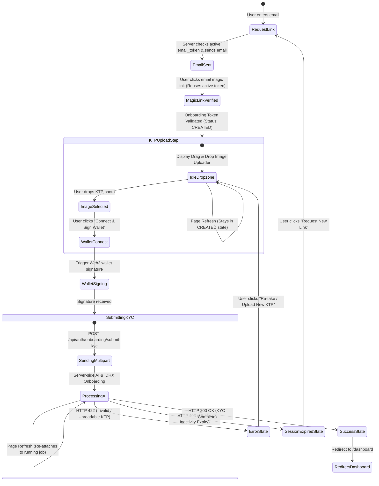

# Technical Specification: Zero-Typing AI KTP Onboarding User Experience

**Service:** `paradapp-client` (Next.js 15 App Router Frontend)  
**Target Audience:** Frontend & UI/UX Engineers / AI Agents  
**Document Version:** 1.2 (Single Active Link per Email & Refresh Resilience)  
**Status:** UI/UX & API Specification  

---

## 1. Overview

This specification details the frontend user experience and API integration changes required for the **Zero-Typing AI KTP Onboarding Flow**. 

Under this implementation:
1. Manual text inputs for NIK (`idNumber`), Full Name (`fullname`), and Address (`address`) are **removed/hidden**.
2. The user simply selects their KTP image file (`idFile`) and connects their Web3 wallet to sign the authorization message.
3. The backend AI microservice pipeline automatically extracts, validates, and registers the identity with IDRX.
4. **Single Active Link per Email:** Requesting a magic link multiple times for the same email reuses the exact same active onboarding token. Clicking any email link in the user's inbox opens the exact same session.
5. **Refresh & Expiry Resilience:** Page reloads do not invalidate the onboarding token. If the session expires due to 15 minutes of inactivity, a clear "Session Expired" UI is displayed with a pre-filled "Request New Link" button.

---

## 2. Updated User Journey & Screen States



---

## 3. Frontend Implementation & Component Changes

### 3.1 Request Link Screen (`/onboarding/request-link`)
- When a user submits their email multiple times or clicks "Resend Link", the server returns the **same active link**.
- The frontend displays: *"Magic link sent! Check your email inbox. (Clicking multiple times reuses your active link)."*

### 3.2 Verification Page Component ([`src/app/[locale]/onboarding/verify/page.tsx`](file:///home/renrensan/project/paradapp/paradapp-client/src/app/%5Blocale%5D/onboarding/verify/page.tsx#L650))

1. **Remove Text Input States:**
   Remove mandatory form validations requiring `fullname`, `address`, and `idNumber` text inputs.

2. **Streamlined Payload Creation (`handleKycSubmit`):**
   Modify the `FormData` construct to only transmit `onboardingToken`, `signature`, `network`, and `idFile`:

   ```typescript
   const formData = new FormData();
   formData.append("onboardingToken", activeToken);
   formData.append("signature", sigToUse);
   formData.append("network", activeNetwork);
   formData.append("idFile", idFile); // KTP Image file binary

   const res = await fetch("/api/auth/onboarding/submit-kyc", {
     method: "POST",
     body: formData,
   });
   ```

3. **Handling AI Quality Gate Failures (`HTTP 422 Unprocessable Entity`):**
   If the backend returns HTTP 422 or 400 (e.g. user uploaded a non-KTP image like a fruit or blurry photo):
   - Catch error JSON (`data.error` or `data.message`).
   - Display a contextual error modal or toast alert:
     - *Bahasa Indonesia:* `"Foto KTP tidak terbaca atau tidak valid. Harap unggah foto KTP yang jelas dan terang."`
     - *English:* `"Unreadable or invalid KTP photo. Please upload a clear photo of your ID card."`
   - Reset step to `KTPUploadStep` allowing the user to select a new image with the same active token.

4. **Handling Expired Session (`HTTP 403 Forbidden` / `ERR_SESSION_EXPIRED`):**
   If the user has been idle for > 15 minutes and the backend returns `ERR_SESSION_EXPIRED`:
   - Set step to `SessionExpiredState`.
   - Render UI banner:
     - *Bahasa Indonesia:* `"Sesi verifikasi Anda telah berakhir demi alasan keamanan (Batas waktu 15 menit)."`
     - *English:* `"Your onboarding session has expired for security reasons (15-minute limit)."`
   - Provide button **"Minta Tautan Baru / Request New Link"** navigating to `/onboarding/request-link?email=...`.

---

## 4. Next.js API Route Proxy ([`src/app/api/auth/onboarding/submit-kyc/route.ts`](file:///home/renrensan/project/paradapp/paradapp-client/src/app/api/auth/onboarding/submit-kyc/route.ts))

Ensure the API route proxy passes through the `multipart/form-data` payload and status codes:

```typescript
export async function POST(req: NextRequest) {
  try {
    const formData = await req.formData();
    const backendRes = await fetch(`${BACKEND_URL}/api/auth/onboarding/submit-kyc`, {
      method: "POST",
      body: formData,
    });

    const data = await backendRes.json();
    return NextResponse.json(data, { status: backendRes.status });
  } catch (err: any) {
    return NextResponse.json({ success: false, error: err.message }, { status: 500 });
  }
}
```

---

## 5. Localization Strings (`messages/id.json` & `messages/en.json`)

Add user-facing messaging strings:

```json
{
  "onboarding": {
    "uploadKtpTitle": "Unggah Foto KTP Anda",
    "uploadKtpSubtitle": "Sistem AI kami akan mengekstrak dan memverifikasi data identitas Anda secara otomatis.",
    "invalidKtpError": "Foto KTP tidak terbaca atau tidak valid. Harap pastikan seluruh bagian KTP terlihat jelas.",
    "sessionExpiredTitle": "Sesi Berakhir",
    "sessionExpiredSubtitle": "Demi keamanan Anda, sesi onboarding akan berakhir setelah 15 menit.",
    "requestNewLinkBtn": "Minta Tautan Verifikasi Baru"
  }
}
```

---

## 6. Verification Strategy

1. **Duplicate Email Link Request Test:** Request link for `user@example.com` 3 times. Confirm all 3 generated emails contain the identical `token` query param.
2. **Page Refresh Test:** Open `/onboarding/verify?token=test-token`. Refresh browser 3 times. Confirm token is not invalidated and upload form remains available.
3. **Expired Session Test:** Call `submit-kyc` with an expired token. Confirm HTTP 403 triggers the "Session Expired" UI with pre-filled email redirect button.
