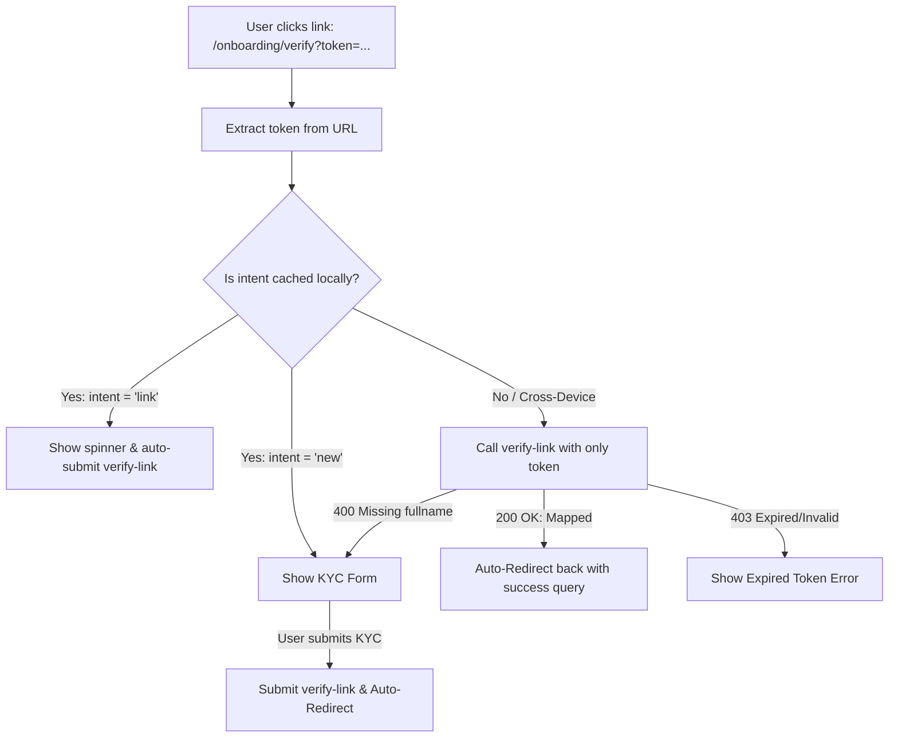

# Frontend Implementation Plan: Onboarding Email Verification & IDRX Migration

This document outlines the frontend implementation plan for the new **IDRX onboarding email verification (magic link)** flow and the **self-custody IDRX migration method** (transitioning from Xendit to Solana-native/cross-chain direct routing).

---

## 1. Relevant Code Audited

### Frontend (paradapp-client)
*   **[`src/subcomponents/BuyToken.tsx`](file:///home/renrensan/project/paradapp/paradapp-client/src/subcomponents/BuyToken.tsx#L561-L591)**: Handles deposit transaction creation by sending a `POST` request to `/api/transaction` with type `DEPOSIT`.
*   **[`src/subcomponents/Assets.tsx`](file:///home/renrensan/project/paradapp/paradapp-client/src/subcomponents/Assets.tsx#L2002-L2032)**: Handles withdrawal transaction creation by sending a `POST` request to `/api/transaction` with type `WITHDRAWAL`.
*   **[`src/app/api/transaction/route.ts`](file:///home/renrensan/project/paradapp/paradapp-client/src/app/api/transaction/route.ts)**: Proxies `/api/transaction` requests directly to `BACKEND_URL/api/transaction`.

### Backend (paradapp-self-custody-service)
*   **[`crates/api/src/transaction.rs`](file:///home/renrensan/project/paradapp/paradapp-self-custody-service/crates/api/src/transaction.rs#L380-L410)**: Validates if the wallet address is onboarded. If not, returns `400 Bad Request` with:
    ```json
    {
      "success": false,
      "tx": null,
      "error": "Wallet address '<walletAddress>' is not onboarded with IDRX. Please complete onboarding first."
    }
    ```
*   **[`crates/api/src/lib.rs`](file:///home/renrensan/project/paradapp/paradapp-self-custody-service/crates/api/src/lib.rs#L133-L134)**: Exposes the onboarding routes:
    *   `POST /api/auth/onboarding/request-link`
    *   `POST /api/auth/onboarding/verify-link` (expects `multipart/form-data`)

---

## 2. Onboarding Bypass & Seamless Transaction Flow

To provide a premium and friction-free user experience, the frontend will implement automatic bypass checks and session preservation to resume transactions after magic link verification.

```
                  [User Clicks Buy / Withdraw]
                               │
                (Try to create transaction via POST)
                               │
             ┌─────────────────┴─────────────────┐
             ▼                                   ▼
     [Success (200 OK)]                [Error (400 Bad Request)]
     (Already Onboarded)             ("not onboarded with IDRX")
             │                                   │
             │                         1. Save Tx details to localStorage
             │                         2. Show Onboarding Request Modal
             │                                   │
             │                            (User requests link)
             │                                   │
             │                        3. Click magic link in email
             │                                   │
             │                          [Verify Landing Page]
             │                        (Executes verification & redirects)
             │                                   │
      [Proceed to Payment /                      │
       Show Deposit Address] <─── 4. Auto-resume transaction using saved details
```

### A. Automatic Onboarding Bypass Check
The frontend will not prompt the user for email verification if their wallet is already onboarded:
1.  **Transaction Attempt**: When the user clicks the action button to deposit or withdraw, the frontend sends a `POST /api/transaction` request.
2.  **No Action Required (Bypass)**: If the wallet is already registered/onboarded, the backend successfully creates the transaction and returns `200 OK` with the transaction ID. The frontend immediately redirects the user to the payment/deposit screen.
3.  **Onboarding Intercept**: If the backend returns `400 Bad Request` with the message `"Wallet address '...' is not onboarded with IDRX..."`, the frontend intercepts this, caches the transaction payload details in `localStorage` under `pending-transaction`, and launches the onboarding request flow.

---

## 3. Directory & File Additions

We will introduce:
1.  **API Next.js Proxy Routes** to forward request-link and verify-link requests to the Rust backend.
2.  **A Shared Onboarding Modal** for Phase 1 verification initiation.
3.  **A Dedicated Verify Link Landing Page** to handle the magic link verification, detect the intent statelessly, and route/auto-redirect the user back to the dApp.

```
src/
├── app/
│   └── api/
│       └── auth/
│           └── onboarding/
│               ├── request-link/
│               │   └── route.ts         # Proxy for Request-Link API
│               └── verify-link/
│                   └── route.ts         # Proxy for Verify-Link API (multipart)
│   └── [locale]/
│       └── onboarding/
│           └── verify/
│               └── page.tsx             # Magic link verification landing page
├── components/
│   └── onboarding/
│       └── OnboardingModal.tsx          # Shared onboarding modal (Phase 1 UI)
```

---

## 4. Implementation Details

### A. Next.js API Proxy Routes

#### 1. `request-link` Proxy (`src/app/api/auth/onboarding/request-link/route.ts`)
Proxies a standard JSON request containing `{ email, walletAddress }` directly to the backend.

#### 2. `verify-link` Proxy (`src/app/api/auth/onboarding/verify-link/route.ts`)
Since verification uses file uploads (the ID card file) under `multipart/form-data`, this proxy parses the incoming multipart request and forwards it dynamically to the backend using `FormData`.

---

### B. Shared Onboarding Modal (`src/components/onboarding/OnboardingModal.tsx`)

This modal manages Phase 1 (Verification Initiation):
1.  **Email Input**: Prompts the user to enter their email address.
2.  **Wallet Address**: Automatically displays the user's active wallet address (connected or manual).
3.  **Request Link**: Calls `POST /api/auth/onboarding/request-link`.
4.  **Check Email Screen**:
    *   Shows a visual indicator instructing the user to check their email inbox.
    *   **Developer Sandbox Hint**: In the development environment, the endpoint returns the raw verification `token` in the response body. The modal will display a convenient bypass link (`/onboarding/verify?token=<token>`) directly in the modal for easy local testing.

---

### C. Magic Link Landing Page (`src/app/[locale]/onboarding/verify/page.tsx`)

This page parses the verification `token` from the query parameters, performs **stateless intent detection**, and automatically redirects the user back to the dApp:



#### Step-by-Step Landing Page Flow:
1.  **URL Parsing**: Retrieve the `token` parameter.
2.  **Determine Intent**:
    *   If the user clicked the link in the **same browser session**, the `intent` ("new" or "link") is retrieved from `localStorage`.
    *   If the user clicked the link on a **different device** (e.g. requested on laptop, clicked email on mobile), `intent` is unknown.
3.  **Cross-Device Stateless Recovery**:
    *   Immediately call `/api/auth/onboarding/verify-link` with only the `token`.
    *   **Result 200 OK**: The intent was `"link"` (existing user matching a new wallet). The backend processed the mapping automatically. Proceed to **Auto-Redirect** (Step 5).
    *   **Result 400 Bad Request (Error: "Missing fullname")**: The intent was `"new"`. Render the KYC Identity Form dynamically.
    *   **Result 403 Forbidden**: Token is expired or invalid. Show a warning page with a "Resend Link" trigger.
4.  **KYC Identity Form (for `intent = "new"`)**:
    *   Form fields: Legal Full Name, Address, ID Number (KTP/NIK), and ID Card Image Upload.
    *   Submit data as `multipart/form-data` to `/api/auth/onboarding/verify-link` with the `token`.
5.  **Seamless Auto-Redirect & Transaction Completion**:
    *   Once `/verify-link` succeeds, show a brief success checkmark animation.
    *   Automatically redirect the user back to the main swap/assets screen (`/[locale]/[network]/vault/buy` or `/[locale]/[network]/vault/assets`) with a query parameter `?verify_success=true`.
    *   **Transaction Auto-Resume**: Upon loading, the dApp checks for `?verify_success=true` and checks if a `pending-transaction` exists in `localStorage`. If found, it automatically executes the transaction request on behalf of the user, creating a seamless end-to-end "one-click" transaction experience.

---

## 5. UI/UX & Styling Specifications
In alignment with design aesthetics, the new screens will be styled to match the dark glassmorphic styling of the main dApp:
*   **KYC Form**: Clean inputs with subtle borders, supporting drag-and-drop file uploads for the ID image.
*   **Check Email Screen**: Smooth pulse animation representing an email check, with a clean fallback input to enter the token manually if needed.
*   **Success Animation**: A vibrant success checkmark animation with custom gradients using Tailwind CSS v4 syntax (e.g. `bg-linear-to-r`).
