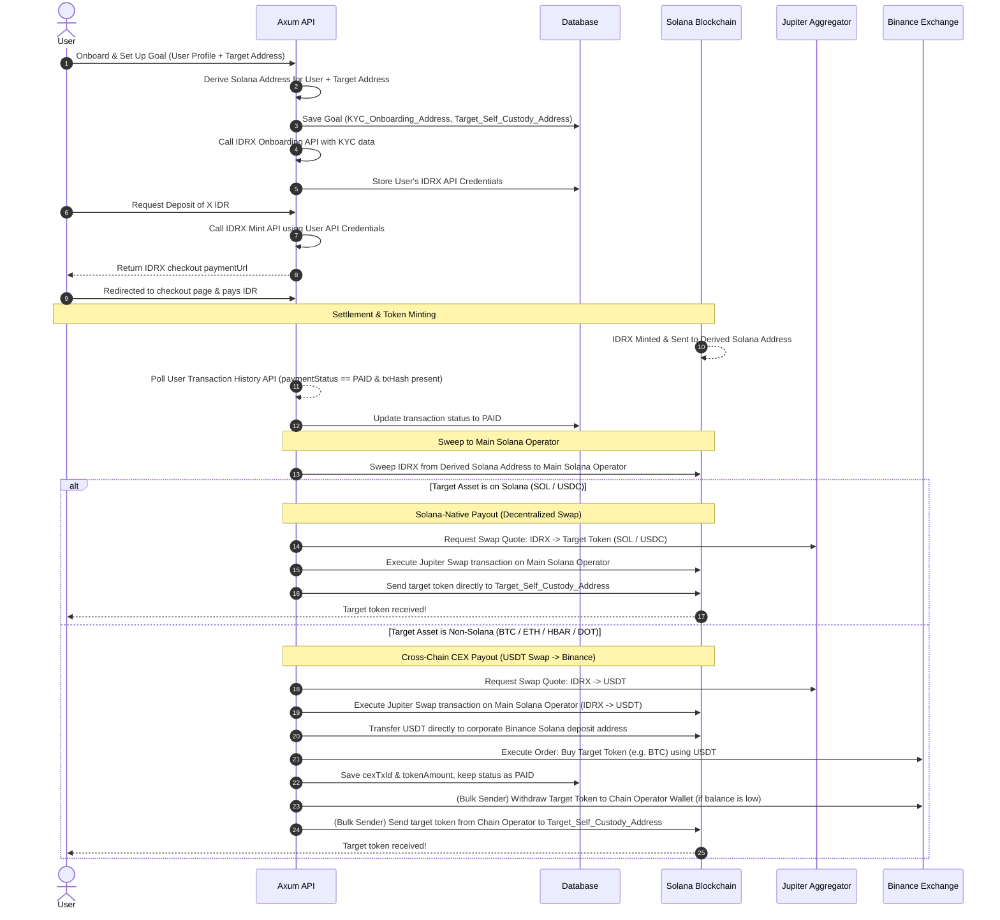

# Self-Custody Architecture & Transaction Routing Flow (Deposit)

This document details the transition from the legacy **Xendit (IDR Fiat)** deposit onboarding flow to the new **IDRX on Solana** onboarding gate. It details user onboarding, derived operator address generation, the minting process, and the end-to-end routing pipeline.

---

## 1. Architectural Summary & Compliance

To satisfy strict KYC compliance requirements, the onboarding architecture enforces the following rules:

* **Solana Funding Gate (IDRX)**: Regardless of the target self-custody asset (e.g. BTC on Bitcoin, ETH on Arbitrum, SOL on Solana), the onboarding deposit is universally initiated using **IDRX (Rupiah stablecoin)** on the **Solana network**.
* **KYC Address Consistency**: Every user is assigned a dedicated, consistent, and permanent deposit address on Solana that maps to their KYC identity.
* **Custodial Control**: While the address is dedicated to the user, the private key is held securely by our system to allow automated detection, signing, and routing of funds.

---

## 2. IDRX User Onboarding

When a new user registers on our platform, we perform an automated onboarding step with IDRX to register their identity. This allows us to retrieve user-specific API keys to sign and execute mint requests under their KYC profile.

### API Integration:
* **Endpoint**: `POST https://idrx.co/api/auth/onboarding`
* **Content-Type**: `multipart/form-data`
* **Headers**:
  * `idrx-api-key`: Platform Developer API Key
  * `idrx-api-sig`: HMAC-SHA256 signature generated using Platform Developer Secret
  * `idrx-api-ts`: Unix timestamp in milliseconds

### Request Parameters:
1. `email` (String): User's email address
2. `fullname` (String): User's full name
3. `address` (String): User's physical address
4. `idNumber` (String): User's identity card number (KTP, etc.)
5. `idFile` (File): Image file of the user's ID card (`jpeg`, `png`, `jpg`, `webp`)

> [!IMPORTANT]
> **Tying User Identity to the Derived Operator Solana Address**:
> * **KYC Association**: The onboarding process submits the **user's actual personal KYC data** (their personal email, fullname, address, ID number, and ID image upload) to IDRX. This verifies and **KYCs the derived operator Solana address** under the user's verified identity.
> * **Minting Compliance**: By using the user's unique API credentials generated from this KYC onboarding, subsequent mint requests to the **Derived Operator Solana Address** are fully tracked and compliant under that user's KYC profile, while keeping the funds under system-controlled keys for automated routing.

### Response Processing:
On successful onboarding (HTTP `201`), IDRX returns the user-specific API credentials:
```json
{
  "statusCode": 201,
  "message": "success",
  "data": {
    "id": 1011,
    "fullname": "JOHN SMITH",
    "createdAt": "2023-12-12T08:10:29.077Z",
    "apiKey": "3d1c15c7afd157a6",
    "apiSecret": "7bb0de01a2cf17c1094db789bfa05eb1adc185482c3ee828a7ba61b683e9b711"
  }
}
```
We store the `apiKey` and `apiSecret` securely in our database (encrypted) linked to the user's profile.

---

## 3. Deterministic Solana Address Derivation

Instead of creating arbitrary standalone wallets, the system uses a **Deterministic Address Derivation** model to map a user's target self-custody wallet to a unique Solana operator address.

### Derivation Input Parameters:
1. **Master Seed**: The system's Solana Master Keypair private key bytes (`keypair.to_bytes()`).
2. **Target Self-Custody Wallet Address (`wallet_address`)**: The destination wallet where the user will receive their purchased tokens.

> [!NOTE]
> An earlier conceptual design proposed two separate inputs: `user_id` + `target_address`. In this implementation, **`wallet_address` serves as both** the user identifier and the target address — there is no separate User table; users are uniquely identified by their wallet address. Therefore a single `wallet_address` input is sufficient and is what the actual code uses.

### 1-to-1 Mapping & Stateless Reusability:
Every unique `wallet_address` maps to a distinct, permanent, and reproducible Solana keypair.

This mathematical derivation provides several key benefits:
* **Strict 1-to-1 Mapping**: If a user submits a deposit request for a destination address they have used before, the derivation input (`wallet_address`) remains identical. This guarantees that the exact same Solana onboarding address is returned.
* **Stateless Key Recovery**: The backend does not store derived private keys in the database. Instead, it re-derives the private key on-the-fly only when signing transactions (e.g. sweeping IDRX to the Main Operator).
* **Permanent Address Reuse**: The user can safely bookmark or reuse the same Derived Operator Solana Address for subsequent funding requests to the same target asset wallet.

### Actual Implementation (Rust):
```rust
pub fn derive_keypair(&self, wallet_address: &str) -> Result<Keypair> {
    use sha2::{Sha256, Digest};

    let mut hasher = Sha256::new();
    hasher.update(self.keypair.to_bytes()); // master keypair bytes as seed
    hasher.update(wallet_address.as_bytes());
    let seed = hasher.finalize(); // 32 bytes

    let mut seed_array = [0u8; 32];
    seed_array.copy_from_slice(&seed);
    Ok(Keypair::new_from_array(seed_array))
}
```

---

## 4. Onboarding Mint Request (Funding Input)

When the user initiates a deposit (e.g. wants to purchase `X` amount of target asset), the system creates a **Mint Request** to IDRX using the user's stored IDRX API credentials.

### API Integration:
* **Endpoint**: `POST https://api.idrx.co/transaction/mint-request`
* **Content-Type**: `application/json`
* **Headers**:
  * `idrx-api-key`: User's stored `apiKey`
  * `idrx-api-sig`: HMAC-SHA256 signature generated using **Platform Developer Secret** (`IDRX_DEVELOPER_SECRET`) using the formula:
    `HMAC-SHA256(DEVELOPER_SECRET, METHOD + ":" + PATH + ":" + SHA256(body) + ":" + timestamp)`
  * `idrx-api-ts`: Unix timestamp in milliseconds
  * `User-Agent`: Must be a custom string (e.g. `paradapp-service/1.0`) to bypass Cloudflare edge protections

### Request Body (Flow A — Hosted Checkout):
```json
{
  "toBeMinted": "1000000",
  "destinationWalletAddress": "<DERIVED_OPERATOR_SOLANA_ADDRESS>",
  "networkChainId": "2",
  "returnUrl": "https://your-app.example.com/callback",
  "requestType": "idrx"
}
```

### Response Processing:
IDRX returns a hosted checkout page URL:
```json
{
  "statusCode": 200,
  "message": "success",
  "data": {
    "id": 1234,
    "merchantOrderId": "20260728130000",
    "reference": "SNAP-20260728130000",
    "checkoutUrl": "https://checkout.idrx.co?token=eyJhbGciOi...",
    "paymentUrl": "https://checkout.idrx.co?token=eyJhbGciOi..."
  }
}
```
1. The frontend directs the user to the `paymentUrl` / `checkoutUrl` or renders the Snap checkout modal.
2. The user pays in IDR.
3. IDRX mints the `IDRX` tokens on Solana and transfers them directly to the `destinationWalletAddress` (the user's Derived Operator Solana Address).

---

## 5. End-to-End Routing Flow & Liquidity Routing

Once the IDRX tokens are minted and land on the Derived Operator Solana Address, the automated routing pipeline begins. The system completely bypasses Indodax, executing on-chain swaps via the **Jupiter DEX Aggregator** and routing USDT directly to Binance for cross-chain delivery.

### Step-by-Step Flow



### Solana Forwarding & Sweep Design (Derived Address -> Main Operator)

Once the user completes the checkout payment, the background worker polls the IDRX User Transaction History API using the user's API credentials. When the API reports `paymentStatus` as `PAID` and provides the on-chain mint `txHash`, the service updates the transaction status to `PAID`, records the `depositTxHash`, and triggers the forwarding worker:

1. **Main Operator Destination Address**:
   * The corporate Main Solana Operator address is defined as an environment variable: `SOL_OPERATOR_ADDRESS` in `.env`.
   * The Associated Token Account (ATA) of this Main address is derived for the `IDRX` mint on-the-fly.

2. **Transaction Fee Funding (Multi-Signature Model)**:
   * Because the derived Solana operator address is clean and only holds the minted IDRX (with zero SOL), it cannot pay its own network transaction fees.
   * To solve this statelessly without sending SOL dust to the user's address, the transaction utilizes **Solana's multi-signature fee-payer capability**:
     * **Fee Payer**: The corporate Master Solana Keypair (`self.keypair`) is set as the fee payer and signs the transaction.
     * **Authority Signer**: The `derived_keypair` signs the transaction to authorize the transfer of the IDRX tokens from its Associated Token Account.
     * **Signers Array**: `[&*self.keypair, &derived_keypair]`
   * **Fee Recovery**: Although the master keypair fronts the SOL for the sweep transaction fee, **this cost is not absorbed by the platform**. The equivalent `~0.0000065 SOL` sweep fee is recovered by deducting it from the user's final token amount during the routing calculation.

3. **Transaction Steps**:
   * If the destination Associated Token Account for `SOL_OPERATOR_ADDRESS` does not exist, we prepend the instruction to create it, funded by the corporate Master Key (`self.keypair`).
   * We append the SPL token transfer instruction using the `derived_keypair` as the source authority and serialize/send the transaction.

---

## 6. Proposed Database Schema Updates

To support the storage of user-specific IDRX API credentials and the intermediate transaction logs without introducing a full `User` table, we implement a lightweight lookup model:

### New `IdrxAccount` Lookup Table:
Since users in this system are identified by their wallet addresses, we store their IDRX onboarding API keys and their uniquely derived operator Solana address in a simple mapping table:
```sql
CREATE TABLE IF NOT EXISTS "IdrxAccount" (
    "walletAddress"        TEXT NOT NULL PRIMARY KEY, -- User's personal target self-custody wallet address
    "idrxApiKey"           TEXT NOT NULL,
    "idrxApiSecret"        TEXT NOT NULL,
    "kycOnboardingAddress" TEXT NOT NULL,             -- Derived Solana Operator Address (KYC)
    "createdAt"            TIMESTAMPTZ NOT NULL DEFAULT NOW(),
    "updatedAt"            TIMESTAMPTZ NOT NULL DEFAULT NOW()
);
```

### No Changes Needed for the `Transaction` Table:
To keep database migrations as minimal as possible, **no new columns are required on the core `Transaction` table**. 

All intermediate routing details, transaction hashes, and order IDs will be stored dynamically inside the existing `paymentDetails` JSONB column:
```json
{
  "method": "IDRX",
  "idrxMintOrderId": "85",
  "depositTxHash": "solana_incoming_transfer_hash",
  "sweepTxHash": "solana_sweep_to_main_operator_hash",
  "jupiterSwapTxHash": "jupiter_swap_tx_signature",
  "binanceDepositTxHash": "solana_usdt_transfer_to_binance_hash"
}
```
The legacy `xenditTxId` column can be ignored or deprecated without dropping it, preventing any breaking schema changes.

---

## 7. Implementation Checklist

* **Deprecate XenditService**:
  * Mark [XenditService](file:///home/renrensan/project/paradapp/paradapp-self-custody-service/crates/infra/src/xendit.rs#L205) as deprecated.
  * Stop calling Xendit checkout links inside the transaction endpoint [handle_create_transaction](file:///home/renrensan/project/paradapp/paradapp-self-custody-service/crates/api/src/transaction.rs#L38).
* **Implement IDRX Onboarding & Mint Service**:
  * Build an `IdrxService` under `crates/infra/src/idrx.rs` implementing:
    * `onboard_user` -> calls onboarding API and retrieves API keys.
    * `request_mint` -> calls mint request using user API keys and custom `User-Agent`.
    * Signature HMAC-SHA256 generation logic.
* **Implement Solana derived keypair generation**:
  * Extend [SolanaService](file:///home/renrensan/project/paradapp/paradapp-self-custody-service/crates/infra/src/blockchain/solana.rs) or add a derivation utility to generate user-specific keypairs from the Solana master key.
* **Implement IDRX transaction history poller**:
  * Instead of polling on-chain signatures, implement a background poller using the IDRX User Transaction History API (`GET /api/transaction/user-transaction-history`) to detect when the payment status becomes `PAID` and retrieve the mint `txHash`.
* **Implement Indodax Trade Executor**:
  * Expand [IndodaxService](file:///home/renrensan/project/paradapp/paradapp-self-custody-service/crates/infra/src/indodax.rs#L17) to support authenticated trading (selling IDRX for USDT) and withdrawal of USDT to the Binance deposit address.
* **Update Payout Execution**:
  * Withdraw target tokens from Binance directly to the user's destination self-custody wallet, updating the transaction status to `COMPLETED` when the withdrawal transaction hash is confirmed.

---

## 8. Proposed Fee Logic Adjustments for the IDRX Flow

With the integration of the IDRX payment flow and direct on-chain routing, there is no longer a need to specify or pass the payment method (`VA` or `QRIS`) to the API endpoint upfront because the user selects it directly on the IDRX hosted checkout page. 

The fee calculation logic (`crates/infra/src/fee.rs`) estimates the token amount by setting the upfront Payment Gateway (PG) fee to `0.0` (since it is handled on the checkout page), while still deducting the platform fee, tax, and slippage buffer. The backend calculates the final estimated token amount starting from the actual received IDRX (the minted amount) and then deducting the subsequent network/exchange fees.

### 8.1. Solana Network Self-Custody (SOL / USDC)

Since the target assets (`SOL` or `USDC`) are swapped directly on-chain on Solana and paid out from the Main Operator Address without touching Binance, we adjust the fees as follows:

> [!IMPORTANT]
> The platform does **not** absorb any on-chain transaction costs. All network costs are recovered from the user's final token amount via the **Network Processing Fee**.

> [!NOTE]
> There is **no separate Platform Swap Fee** for Solana. Jupiter's `outAmount` (used for both the estimate quote and the actual on-chain swap) already reflects the net amount received after all routing and swap costs. Deducting an additional percentage would be double-counting.

> [!NOTE]
> **Referral Allocation is a split of the Platform Fee, not an extra charge.** The total deducted from the user for platform purposes is always `0.5%`. When a referrer exists, it is split as `0.25%` to the platform and `0.25%` forwarded to the referrer.

| Fee Component | Value | Rationale |
| :--- | :--- | :--- |
| **Platform Fee** | `0.5%` of `outAmount` (or `0.25%` to platform + `0.25%` to referrer if referrer exists) | Platform revenue. Total always `0.5%` of base. |
| **Network Processing Fee** | `0.5%` of `outAmount` | Covers all on-chain transfer costs: sweep (Derived → Operator) + payout (Operator → User). Token-agnostic, no price lookup needed. |

---

### 8.2. Non-Solana Network Self-Custody (BTC / ETH / HBAR / DOT)

For other blockchains, the flow still requires swap-to-USDT, Binance deposit, Binance market buy, and Binance withdrawal to the Operator address:

> [!IMPORTANT]
> The platform does **not** absorb any on-chain transaction costs. All network costs are recovered from the user's final token amount via the **Network Processing Fee**.

> [!NOTE]
> Jupiter's `outAmount` for the IDRX → USDT swap already reflects net USDT received after all routing costs. The **Binance Trade Fee** is a separate and real charge applied by Binance on the spot USDT → target token market order — it is not covered by Jupiter.

> [!NOTE]
> **Referral Allocation is a split of the Platform Fee, not an extra charge.** The total deducted from the user for platform purposes is always `0.5%`. When a referrer exists, it is split as `0.25%` to the platform and `0.25%` forwarded to the referrer.

| Fee Component | Value | Rationale |
| :--- | :--- | :--- |
| **Platform Fee** | `0.5%` of `bought_amount` (or `0.25%` to platform + `0.25%` to referrer if referrer exists) | Platform revenue. Total always `0.5%` of base. |
| **Binance Trade Fee** | `0.1%` of `bought_amount` | Real Binance spot trading fee on the USDT → target token market order. Not covered by Jupiter. |
| **Network Processing Fee** | `0.5%` of `bought_amount` | Covers all on-chain transfer costs: sweep (Derived → Operator), USDT transfer (Operator → Binance), and target-chain payout (Chain Operator → User). Token-agnostic, no price lookup needed. |
| **Binance Withdrawal Fee** | Live from Binance API (fixed token amount) | Binance charges this to withdraw the target token to the Chain Operator wallet. Separate from Network Processing Fee. |
