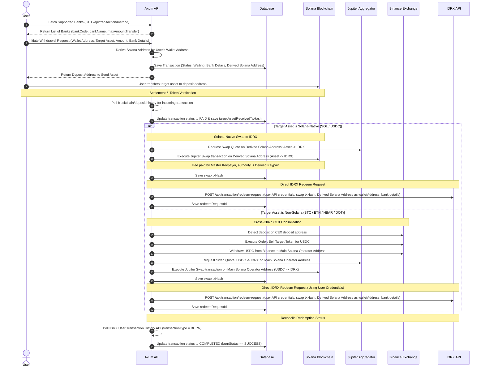

# Self-Custody Architecture & Transaction Routing Flow (Withdrawal)

This document details the transition from the legacy **Xendit (IDR Fiat)** withdrawal onboarding flow to the new **USDC on Solana** withdrawal gate. It details user onboarding, derived operator address generation, the token consolidation process into USDC, and the end-to-end routing pipeline.

---

## 1. Architectural Summary & Compliance

To satisfy strict KYC compliance requirements, the withdrawal architecture enforces the following rules:

* **Solana Payout Gate (IDRX)**: Regardless of the source self-custody asset (e.g. BTC on Bitcoin, ETH on Arbitrum, SOL on Solana), the withdrawal is ultimately converted into **IDRX (Rupiah stablecoin)** on the **Solana network** before executing the bank transfer payout.
* **Direct IDRX Redemption**: By swapping assets to IDRX on-chain, we utilize IDRX's native redemption gateway (`POST /api/transaction/redeem-request`) to disburse IDR directly to the user's bank account. This removes the reliance on third-party fiat disbursement services (like Xendit) and uses the user's verified IDRX credentials.
* **KYC Address Consistency**: Every user is assigned a dedicated, consistent, and permanent Derived Solana Address that maps to their KYC identity.
* **Custodial Control**: While the address is dedicated to the user, the private key is held securely by our system to allow automated detection, signing, and routing of funds.

---

## 2. IDRX User Onboarding & Bank Methods

When a new user registers on our platform or initiates a withdrawal, we perform an automated onboarding step with IDRX to register their identity. This allows us to retrieve user-specific API keys to comply with KYC regulations.

### API Integration (Onboarding):
* **Endpoint**: `POST https://idrx.co/api/auth/onboarding`
* **Content-Type**: `multipart/form-data`
* **Headers**:
  * `idrx-api-key`: Platform Developer API Key
  * `idrx-api-sig`: HMAC-SHA256 signature generated using Platform Developer Secret
  * `idrx-api-ts`: Unix timestamp in milliseconds

### Request Parameters:
1. `email` (String): User's email address
2. `fullname` (String): User's full name
3. `address` (String): User's physical address
4. `idNumber` (String): User's identity card number (KTP, etc.)
5. `idFile` (File): Image file of the user's ID card (`jpeg`, `png`, `jpg`, `webp`)

### Retrieve Supported Bank Methods:
To check supported banks for the bank transfer payout, the platform calls the IDRX Get Methods API:
* **Endpoint**: `GET https://idrx.co/api/transaction/method`
* **Headers**:
  * `idrx-api-key`: Platform Developer API Key
  * `idrx-api-sig`: HMAC-SHA256 signature
  * `idrx-api-ts`: Unix timestamp in milliseconds
* **Response**: Returns a list of banks containing `bankCode`, `bankName`, and `maxAmountTransfer`.

---

## 3. Deterministic Solana Address Derivation

Instead of creating arbitrary standalone wallets, the system uses a **Deterministic Address Derivation** model to map a user's target self-custody wallet to a unique Solana operator address.

### Derivation Input Parameters:
1. **Master Seed**: The system's Solana Master Keypair private key bytes (`keypair.to_bytes()`).
2. **Target Self-Custody Wallet Address (`wallet_address`)**: The wallet where the user holds their assets.

### 1-to-1 Mapping & Stateless Reusability:
Every unique `wallet_address` maps to a distinct, permanent, and reproducible Solana keypair.

This mathematical derivation provides several key benefits:
* **Strict 1-to-1 Mapping**: If a user submits a withdrawal request for a destination address they have used before, the derivation input (`wallet_address`) remains identical. This guarantees that the exact same Solana address is returned.
* **Stateless Key Recovery**: The backend does not store derived private keys in the database. Instead, it re-derives the private key on-the-fly only when signing transactions (e.g. sweeping USDC to the Main Operator).
* **Permanent Address Reuse**: The user can safely bookmark or reuse the same Derived Operator Solana Address for subsequent withdrawal requests.

---

## 4. Withdrawal Request & Funding Input

When the user initiates a withdrawal (e.g. wants to sell `X` amount of target asset for IDR), the system creates a withdrawal transaction.

### Request Body:
The API endpoint accepts the user's self-custody wallet address, the source asset, the amount to withdraw, and their bank payout details (using bank details validated against `GET /api/transaction/method`):
```json
{
  "walletAddress": "<USER_SELF_CUSTODY_WALLET_ADDRESS>",
  "tokenType": "SOL",
  "tokenAmount": "1.5",
  "paymentDetails": {
    "bankCode": "014",
    "bankName": "BANK CENTRAL ASIA",
    "bankAccountName": "JOHN SMITH",
    "bankAccount": "1234567890"
  }
}
```

### Response Processing:
1. The backend returns the designated deposit address (Derived Solana Operator Address for Solana-native tokens, or corporate deposit/Binance addresses for non-Solana tokens) to the user.
2. The user transfers the target asset from their self-custody wallet to the designated deposit address.
3. The background worker monitors the block transactions until the incoming transfer is confirmed on-chain, updating the transaction status to `PAID`.

---

## 5. End-to-End Routing Flow & Liquidity Routing

Once the target asset lands on the designated deposit address and the payment is confirmed, the automated routing pipeline begins. 

There is a key difference in how Solana-native and non-Solana assets are routed:
* **Solana-native assets (SOL / USDC)**: Swapped to **IDRX** directly on the user's Derived Solana Address using the Jupiter aggregator. The network fee for this swap is funded by the Master Keypair. Once swapped, the IDRX is redeemed straight to the user's bank account via the IDRX Redeem API, using the user's IDRX API credentials and the user's Derived Solana Address as the `walletAddress`.
* **Non-Solana assets (BTC / ETH / HBAR / DOT)**: Deposited to the corporate Binance address and sold for **USDC**. The USDC is then withdrawn to the Main Solana Operator Address. On the Main Solana Operator Address, we swap USDC to **IDRX** on-chain via Jupiter. We then call the IDRX Redeem API to disburse the funds straight to the user's bank account using the user's IDRX API credentials and the user's Derived Solana Address as the `walletAddress`.

The consolidated IDRX is finally redeemed to the user's bank account via the IDRX Redeem Request API under their KYC-onboarded credentials.

### Step-by-Step Flow



### Solana On-Chain Swap Design & Multi-Signature Fee Funding

For Solana-native assets, the target token (e.g., SOL or USDC) is swapped to IDRX directly on the Derived Solana Address.

1. **Transaction Fee Funding (Multi-Signature Model)**:
   * Since the derived Solana operator address only holds the target token (and potentially no SOL for gas, especially if it was a USDC withdrawal), it might not be able to pay its own network transaction fees for the Jupiter swap.
   * To solve this statelessly, the swap transaction utilizes **Solana's multi-signature fee-payer capability**:
     * **Fee Payer**: The corporate Master Solana Keypair (`self.keypair`) is set as the fee payer and signs the transaction.
     * **Authority Signer**: The `derived_keypair` signs the transaction to authorize the swap of the tokens on its Derived Solana Address.
     * **Signers Array**: `[&*self.keypair, &derived_keypair]`
   * **Fee Recovery**: Although the master keypair fronts the SOL for the swap transaction fee, this cost is recovered by deducting the equivalent SOL fee (converted to IDRX) from the user's final redemption payout.

2. **Direct Redemption Request**:
   * Once the Jupiter swap to IDRX is executed on the Derived Solana Address, we call the IDRX Redeem API directly. There is no sweep to the Main Operator address required for Solana-native withdrawals.

### Non-Solana On-Chain Swap Design (Main Operator -> IDRX)

For non-Solana assets, the target token is deposited to Binance, sold for USDC, and withdrawn to the Main Solana Operator Address.

1. **Swap on Main Operator**:
   * Once USDC lands on the Main Solana Operator Address, we execute a Jupiter swap from USDC to IDRX. The transaction fees are paid directly by the Main Solana Operator Address.
2. **Redemption Request**:
   * After the swap, we call the IDRX Redeem API using the transaction hash (`txHash`) of the swap on the Main Solana Operator Address, the user's IDRX API credentials, and the user's Derived Solana Address as the `walletAddress` to comply with KYC tracing requirements.

---

## 6. Proposed Database Schema Updates

To support the storage of user-specific IDRX API credentials and the intermediate transaction logs without introducing a full `User` table, we implement the lightweight lookup model:

### `IdrxAccount` Lookup Table:
We store user IDRX onboarding API keys and their uniquely derived operator Solana address in the same mapping table:
```sql
CREATE TABLE IF NOT EXISTS "IdrxAccount" (
    "walletAddress"        TEXT NOT NULL PRIMARY KEY, -- User's personal self-custody wallet address
    "idrxApiKey"           TEXT NOT NULL,
    "idrxApiSecret"        TEXT NOT NULL,
    "kycOnboardingAddress" TEXT NOT NULL,             -- Derived Solana Operator Address (KYC)
    "createdAt"            TIMESTAMPTZ NOT NULL DEFAULT NOW(),
    "updatedAt"            TIMESTAMPTZ NOT NULL DEFAULT NOW()
);
```

### Dynamic `paymentDetails` JSONB Fields:
No database schema changes are required for the `Transaction` table. All routing details, transaction hashes, and payout details will be stored dynamically inside the `paymentDetails` JSONB column:
```json
{
  "bankCode": "014",
  "bankName": "BANK CENTRAL ASIA",
  "bankAccount": "1234567890",
  "bankAccountName": "JOHN SMITH",
  "targetAssetReceivedTxHash": "solana_incoming_transfer_hash",
  "jupiterSwapTxHash": "jupiter_swap_to_idrx_hash",
  "binanceTradeOrderId": "binance_sell_order_id",
  "binanceWithdrawTxHash": "binance_withdraw_usdc_hash",
  "idrxRedeemRequestId": 14,
  "idrxRedeemStatus": "SUCCESS"
}
```

---

## 7. Implementation Checklist

* **Update Transaction Creation Endpoint**:
  * Accept withdrawal requests with bank payout details (retrieved via `GET /api/transaction/method` to ensure validity) and self-custody wallet address.
  * Return the Derived Solana Operator Address (for Solana-native) or corporate deposit address (for non-Solana) to the frontend.
* **Implement Incoming Payment Monitor**:
  * Build a worker to scan/poll the Derived Solana Address or Binance/corporate deposit wallets for incoming target assets matching the transaction amount.
  * Update transaction status to `PAID` once the incoming transaction is confirmed on-chain.
* **Implement Solana Swap & Redeem**:
  * Add logic to execute Jupiter swaps: Target Token (SOL/USDC) -> IDRX on the Derived Solana Address using multi-signature fee funding.
  * Retrieve user's IDRX API credentials from `IdrxAccount` using the user's self-custody wallet address.
  * Call the IDRX Redeem API (`POST /api/transaction/redeem-request`) with the swap transaction hash, bank details, and the user's Derived Solana Address as `walletAddress`.
* **Implement Non-Solana Swap & Route**:
  * Expand Binance integration to execute sell orders (Target Token -> USDC) and withdraw USDC to the Main Solana Operator Address.
  * Execute Jupiter swap: USDC -> IDRX on the Main Solana Operator Address.
  * Retrieve user's IDRX API credentials from `IdrxAccount`.
  * Call the IDRX Redeem API with the swap transaction hash, bank details, and the user's Derived Solana Address as `walletAddress`.
* **Reconcile Redemption Status**:
  * Update the background worker (`check_withdrawal_payout_status`) to track the IDRX redemption status by polling the User Transaction History API (`GET /api/transaction/user-transaction-history?transactionType=BURN`).
  * Mark the transaction as `COMPLETED` once `burnStatus` is `SUCCESS`.

---

## 8. Proposed Fee Logic Adjustments for the Withdrawal Flow

For the withdrawal flow, fees are deducted from the starting crypto asset amount, resulting in a net IDRX amount that is then redeemed to IDR via the IDRX redemption gateway.

### 8.1. Solana Network Self-Custody (SOL / USDC)

Since the source assets (`SOL` or `USDC`) are swapped directly on-chain to IDRX on Solana and redeemed, the fees are adjusted as follows:

> [!IMPORTANT]
> All network costs, platform fees, statutory taxes, and redemption gateway fees are recovered from the user's final IDR payout.

| Fee Component | Value | Rationale |
| :--- | :--- | :--- |
| **Platform Fee** | `0.5%` of `tokenAmount` | Platform revenue. Split 50/50 with referrer if a referrer exists. |
| **Tolerance Fee** | `0.5%` of `tokenAmount` | Buffer fee protecting the platform from price slippage during transaction routing. |
| **Withdrawal Tax** | `0.21%` of `tokenAmount` | Indonesian statutory crypto sales tax (VAT/Income tax matching `TAX_PERCENT`). |
| **Network Processing Fee** | `0.5%` of `tokenAmount` | Covers on-chain swap fees to IDRX on Solana. |
| **IDRX Redemption Fee** | Dynamic from IDRX API or tier-based: `5,000 IDR` for ≤ Rp250,000,000; `35,000 IDR` for > Rp250,000,000 | Fee charged by the IDRX redemption gateway. Checked via `GET /api/transaction/get-additional-fees?feeType=REDEEM`. |

---

### 8.2. Non-Solana Network Self-Custody (BTC / ETH / HBAR / DOT)

For other blockchains, the flow requires Binance deposit, Binance spot trading to USDC, Binance USDC withdrawal to Solana, Jupiter swap to IDRX, and IDRX redemption:

> [!IMPORTANT]
> All network, trade, tolerance, tax, and redemption gateway costs are recovered from the user's final IDR payout.

| Fee Component | Value | Rationale |
| :--- | :--- | :--- |
| **Platform Fee** | `0.5%` of `tokenAmount` | Platform revenue. Split 50/50 with referrer if a referrer exists. |
| **Tolerance Fee** | `0.5%` of `tokenAmount` | Buffer fee protecting the platform from price slippage during transaction routing. |
| **Withdrawal Tax** | `0.21%` of `tokenAmount` | Indonesian statutory crypto sales tax (VAT/Income tax matching `TAX_PERCENT`). |
| **Binance Trade Fee** | `0.1%` of `tokenAmount` | Real Binance spot trading fee on the target token → USDC market order. |
| **Network Processing Fee** | `0.5%` of `tokenAmount` | Covers cross-chain transfer costs: sweep, USDC transfer to Solana, and Jupiter swap. |
| **Binance Withdrawal Fee** | Live from Binance API | Binance withdrawal fee for sending USDC to Solana. |
| **IDRX Redemption Fee** | Dynamic from IDRX API or tier-based: `5,000 IDR` for ≤ Rp250,000,000; `35,000 IDR` for > Rp250,000,000 | Fee charged by the IDRX redemption gateway. Checked via `GET /api/transaction/get-additional-fees?feeType=REDEEM`. |

---

## 9. Decided Flow: Universal IDRX Payout Gate

The platform implements a unified IDRX redemption mechanism:
* **Solana-native Assets (SOL / USDC)**: Swapped to IDRX directly on the user's Derived Solana Address and redeemed immediately. No sweep to Main Operator required.
* **Non-Solana Assets (BTC / ETH / HBAR / DOT)**: Deposited to Binance, sold for USDC, and withdrawn to the corporate **Solana Main Operator wallet**. On the Main Solana Operator wallet, we swap USDC to IDRX on-chain and redeem using the user's IDRX credentials, passing the user's Derived Solana Address as `walletAddress` to comply with KYC registration rules.
